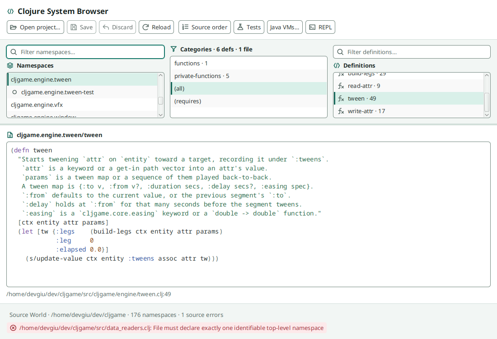
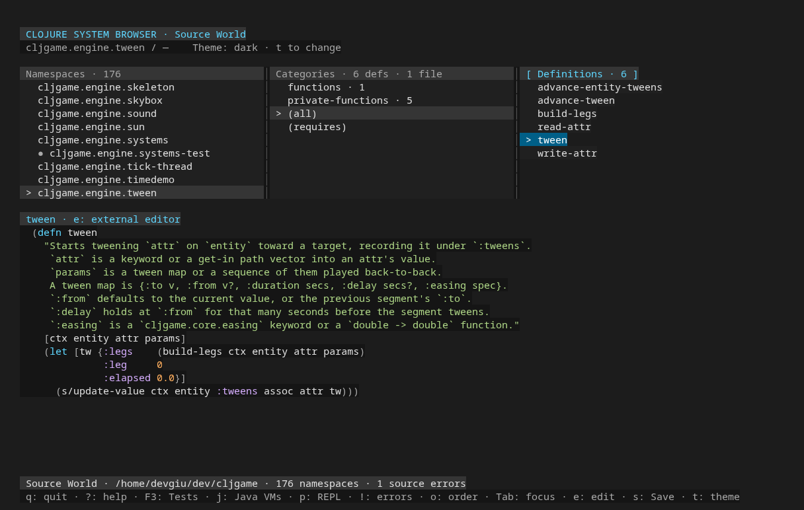
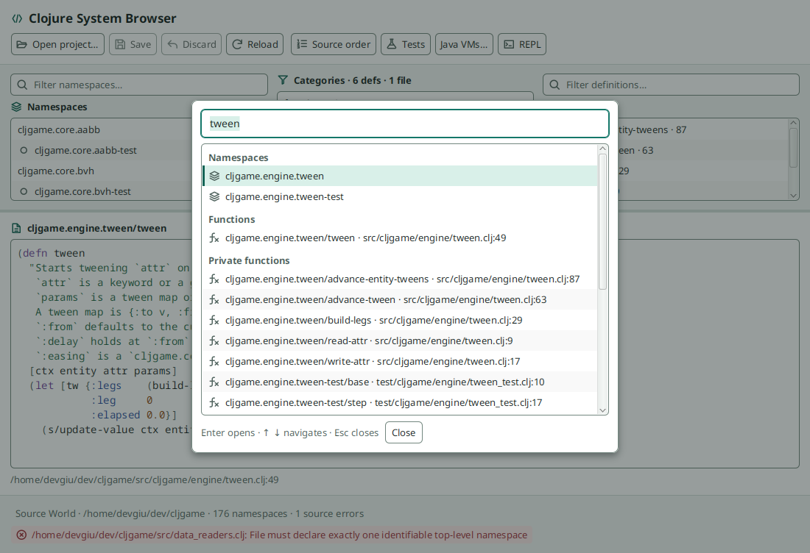

# Clojure System Browser

A Smalltalk-inspired browser for Clojure definitions. Regular project source files
remain the persistent source of truth. **Source World** works independently of
the optional nREPL panel in Desktop and TUI.

## Screenshots

Both clients consume the same headless service and the same use cases. The
captures below browse the same real external project (176 namespaces).

| Desktop (cljfx/JavaFX) | TUI (Lanterna) |
|---|---|
|  |  |

Press `f` in the TUI to search namespace and definition names. Desktop opens
its search overlay with Ctrl+F or Cmd+F.



## ⚠️ Disclaimer

This project is a **rapid prototype** built exclusively through **vibe coding** (100% AI-assisted development).

The main goal was to validate an idea and get a working MVP as fast as possible. As a result, the codebase may contain unoptimized logic, edge-case bugs, or lack strict architectural patterns and test coverage. **Use at your own risk**—it is not intended for production environments.

## Installation

Install the released TUI/CLI by putting its two assets — the `csb` launcher
script and the uberjar — in a directory on your `PATH`:

```sh
mkdir -p ~/.local/opt/csb && cd ~/.local/opt/csb
curl -sLO https://github.com/DevGiuDev/clojure-system-browser/releases/download/v0.3.1/csb
curl -sLO https://github.com/DevGiuDev/clojure-system-browser/releases/download/v0.3.1/clojure-system-browser-0.3.1.jar
chmod +x csb
export PATH="$HOME/.local/opt/csb:$PATH"
csb --project /path/to/project
```

`csb` accepts the same options as `clojure -M:tui` (`--project`,
`--source-root`, `--example-extension`) and honors `JAVA_CMD` to select the
Java binary. The jar runs the TUI (`csb.tui` is the main class) on Java 21
or later and contains no JavaFX. The Desktop is not packaged: it needs a
JDK 25 or later and this repository's JavaFX 27 dependencies, so it runs
from a checkout as described in [Requirements and versions](#requirements-and-versions).

## Current status

- Source World: discovery of `.clj`, `.cljc` and `.cljd` files, indexing,
  counted category facets with a namespace summary, a shared service, editing
  sessions, a CLI and a minimal extension
  registry. Saving is limited to unambiguous `defn`/`defn-` forms in `.clj` files,
  preserving surrounding bytes, detecting conflicts and retaining drafts on error.
- Select **(requires)** under **Categories** in Desktop or TUI to read the
  current namespace's `:require` and `:require-macros` declarations, including
  aliases, options and reader conditionals.
- Desktop (`cljfx`/JavaFX): project opening, navigation, filtering, a code editor
  with syntax highlighting, selection, undo/redo and Save/Discard/Reload.
  The **Uses** panel beside the code follows the selected function, var, macro
  or multimethod and lists the definitions that reference it.
  Context menus in the editor and **Definitions** open a definition or find
  symbol uses and related tests. Tested with real JavaFX 27 headless controls.
- TUI (Lanterna): navigation, project search, resizing, dark/light themes,
  syntax highlighting shared with Desktop, updates only on changes, external editing,
  Save/Ctrl+S and draft recovery. Tested with a virtual terminal and real Vim in
  a PTY, including quoted editor commands and visible failure details. The user
  confirms that the theme is readable in Emacs/EXWM, and on 2026-11-21 confirmed
  the emacsclient editing round-trip there (edit in an existing frame, return
  with `C-x #`, save from the TUI); this does not yet cover syntax
  highlighting or the complete manual workflow in that session.
- Source order view: a read-only panel in both clients (the **Source order**
  button in Desktop, `o` in the TUI) shows the real file order of top-level
  forms of the current namespace, marking the selected definition. Shared
  through the same service; see [ADR 008](docs/decisions/008-source-order-view.md).
- Desktop and TUI can connect to an existing nREPL, evaluate expressions and
  definitions separately from Save, and browse loaded namespaces, vars and metadata.
  The Combined view compares names in the runtime and the project's source index.
  Top-level `(comment …)` forms of the current namespace appear under a counted
  **(comment)** category: the whole block is shown read-only, and evaluating it
  sends its body forms one by one, stopping at the first error. Selected code
  in the editor can be evaluated as typed from the Desktop context menus.
  See [REPL walkthrough](#repl-walkthrough) and [verification](docs/verification.md).
- The SUnit-inspired **Tests** view runs the project's test command in a
  background process. Both clients stream output and show the result beside
  each test and namespace. See [Test Runner](#test-runner).
- The MVP **is not considered complete** until the full interaction workflow has
  been demonstrated in both clients on supported systems.
  See the [roadmap](docs/roadmap.md).

## Requirements and versions

Recommended: JDK 27 and Clojure CLI 1.12.6.1673. Desktop requires JDK 25 or later.
The core uses Clojure 1.12.6. Dependency versions are pinned in `deps.edn`:

**What matters is the Java executable used by Clojure CLI.** `-Srepro` does not
select a JDK, and setting `JAVA_HOME` alone may not change it if the launcher
prioritizes `java` on PATH. If Java 21 is the system default, select JDK 27 for
one invocation without changing global configuration:

```sh
JAVA_CMD=/usr/lib/jvm/java-27-openjdk/bin/java clojure -Srepro -M:desktop --project examples/sample-project
```

That path matches this Linux installation; use your own JDK path on another
machine. Alternatively, prepend its `bin` directory to PATH and set `JAVA_HOME`
to the same JDK. Check the Java version actually used by Clojure with:

```sh
clojure -Srepro -M -e '(println (System/getProperty "java.version"))'
```

Desktop checks the version before loading JavaFX and displays a clear message
if the JDK is too old. An `UnsupportedClassVersionError` mentioning class version
69 and a maximum of 65 means Java 25 bytecode is being loaded by Java 21.

| Dependency | Version | Scope |
|---|---|---|
| Clojure | 1.12.6 | Core and clients |
| rewrite-clj | 1.3.59 | Source adapter |
| cljfx | 1.10.363 | Desktop only |
| JavaFX | 27.0.1 | Desktop only |
| RichTextFX | 0.11.7 | Code editor, Desktop only |
| Lanterna | 3.1.5 | TUI only |
| nREPL | 1.7.0 | Desktop, TUI and Live integration tests |

Initial dependency resolution requires Maven Central and Clojars access.
`-Srepro` avoids inheriting dependencies from personal Clojure CLI configuration.

```sh
java -version
clojure -Sdescribe
clojure -Srepro -M:test
clojure -Srepro -M:cli --project examples/sample-project
clojure -Srepro -M:cli --project examples/poly-sample-project
clojure -Srepro -M:desktop --project examples/sample-project --example-extension
clojure -Srepro -M:tui --project examples/sample-project --example-extension
```

Run these commands **from the Clojure System Browser directory**, which contains
its `deps.edn`. `:tui` and `:desktop` are aliases defined by this repository.
`--project` selects the source project to browse; it does not select the
`deps.edn` used by Clojure CLI to launch the application. For a sibling project:

```sh
cd /path/to/clojure-system-browser
JAVA_CMD=/path/to/jdk-27/bin/java clojure -Srepro -M:tui --project ../another-project
```

If Clojure tries to open `--project` as a file and reports
`FileNotFoundException`, execution has not reached the browser's `-main`.
Check the working directory and that its `deps.edn` defines `:tui`. To check the
alias and regenerate its launch cache once, without opening the terminal UI:

```sh
clojure -Srepro -Sforce -M:tui --help
```

This should print the application version and the CSB help starting with
`clojure -M:tui --project PATH`. The version is the one declared in
`csb.cli/version` and recorded in [CHANGELOG.md](CHANGELOG.md).
If the launch cache also needs rebuilding when opening a project, place
`-Sforce` before `-M:tui`. Do not change the `deps.edn` of the project you want
to browse.

Source roots come from `:paths` in the project's `deps.edn`, with `src` and
`test` as the default. The browser also indexes the conventional test
directory, literal paths in recognized test aliases and test paths in
Kaocha's `tests.edn`. Opening the project reads configuration as data. To set
the exact roots, repeat `--source-root`:

```sh
clojure -Srepro -M:tui --project /path/to/project --source-root src --source-root test
```

In a Polylith workspace there is no top-level `src`. When the project contains
a `workspace.edn` (or the older `.polylith` configuration), or both `components`
and `bases` folders, and `deps.edn` declares no top-level `:paths`, the browser
derives the conventional brick layout from the filesystem alone: every brick
under `components` and `bases` contributes its `src` and `test`, `development`
contributes `src` and `test`, and each project under `projects` contributes its
rare `src`. `workspace.edn` and aliases are never executed; explicit
`--source-root` options and `deps.edn` `:paths` still take precedence.
`examples/poly-sample-project` is a minimal browsable workspace with that layout.

Only roots within the project are accepted. Symbolic links, `target`, `.git`,
caches and `node_modules` are ignored. `project.clj` is not evaluated.

Discovery includes `.clj`, `.cljc` and ClojureDart `.cljd` files. `.cljd` files
can be browsed **read-only**, without resolving their dependencies or starting
Dart or Flutter. **Open project…** detects the selected project's source roots
and clears the previous definition and namespace filters; startup
`--source-root` options apply only to the initial project. If no namespaces
are found, the status bar shows the roots searched and the supported file
formats.

## Source World walkthrough

1. Open `examples/sample-project` in Desktop. All definitions of `shop.orders`
   are listed by default; the Categories panel shows counted facets
   (`functions · 2`) and `(all)`. Select the `functions` facet and then the
   `total` definition. The editor shows only that form.
2. Change the body and press **Save** or Ctrl+S / Cmd+S. Bytes before and after
   the definition are preserved, including comments and CRLF line endings.
3. Leave a parenthesis unclosed: Save must report the error and retain the draft.
   Fix the text or press **Discard**.
4. With a pending draft, modify the file from another application. Save must show
   a conflict. To accept the version on disk: **Discard**, then **Reload**.
5. Open the TUI on the same project: it displays the same service data. Tab
   changes lists and the arrow keys select items. `?` shows help and `!` shows
   project source errors.
6. With `--example-extension`, Desktop offers a greeting command and a summary
   view. In the TUI, `x` invokes the first command and `v` the first view.
7. Press **Source order** in Desktop or `o` in the TUI: both show the real file
   order of top-level forms — `(ns shop.orders)` first, then `total`,
   `discount`, `receipt` — with the selected definition marked. `Esc` or the
   button returns to the editor; selecting an entry in Desktop navigates to it.
8. In Desktop, right-click `total` in **Definitions** and choose **Find related
   tests**. Open `shop.orders-test/total-test` from the results, then right-click
   `orders/total` in the editor and choose **Go to definition**. The menu uses
   the definition name when there is no symbol under the pointer. With the
   keyboard, open the context menu at the caret or on the selected row.
   The **Uses** panel for `total` shows `receipt` and `total-test`, each with
   the file and line of its first use. Press Enter on a row to open that
   definition. Closing contextual results brings back the automatic list.
9. In Desktop, type in the filter boxes above **Namespaces** and **Definitions**
   to narrow those lists. Clear a filter to restore all entries. Check **Tree**
   next to **Namespaces** to group names by their dot-separated segments.
   Uncheck it to return to the flat list.
10. From the source browser, press `f` in the TUI or Ctrl+F / Cmd+F in Desktop.
    Type part of a namespace name or a qualified `namespace/name`.
    Matches ignore case and show namespaces before definition categories.
    Use ↑/↓ to select, Enter to open and Esc to close. Save or discard a pending
    draft before opening a result. In Desktop, clicking the background also
    closes the panel.

Navigation, reload, opening another project and normal exit are blocked while
there is a draft to save or discard. Desktop disables the lists while a draft
is pending to keep the visible selection aligned with the edited definition.
The full manual walkthrough and platform records are in
[acceptance](docs/acceptance.md).

The Desktop code panel highlights special forms, keywords, strings, regular
expressions, comments, numbers, literals, characters and delimiters. Highlighting
updates while editing, including incomplete forms and read-only definitions.
It is lexical: it does not resolve symbols or evaluate code, and it does not
certify that a draft can be saved. The editor preserves selection, copy/paste,
undo/redo and scrolling in both directions. The TUI uses the same lexical
classifier for its code panel, including incomplete drafts and read-only
sources. Colors adapt to both themes, and multiline strings keep their style
when scrolling. External editing uses the highlighting provided by `$EDITOR`.

### Terminal editing

The TUI has its own dark theme with explicit backgrounds, separate panels,
a highlighted selection and colors for errors and pending changes. Press `t`
to switch between dark and light; the choice lasts for the session, including
reloads and editor handoffs. Save it from the settings panel (`g`) to keep it
between sessions. A terminal with 256-color support is required.
The application uses the extended palette instead of inheriting the terminal's
background or basic 16 ANSI theme colors. It does not change the Emacs/EXWM or
external editor theme. `?` lists the available keys.

The screen updates when state or size changes, sending only differences to the
terminal. It does not redraw or emit output while idle. Startup, resizing and
returning from the external editor rebuild the complete screen.

`e` opens an **external editor on a temporary file containing one definition**.
It never opens the original project file. The code panel displays source and
drafts; text editing happens in the external editor. On return, CSB imports a
draft. `s` / Ctrl+S saves through the same service used by Desktop, and `d`
discards it.

Editor selection follows this order: the settings `:editor-command` argv (see
[Settings](#settings)), `CSB_EDITOR_ARGS`, `$VISUAL`, `$EDITOR`,
then `vi`. Empty `VISUAL`/`EDITOR` values are ignored. These two variables accept
commands with quoted arguments, such as `EDITOR='vim -f'` or
`VISUAL='emacsclient'`. No shell is invoked, and variables, globs and command
substitutions are not expanded. If a value is the literal path of an existing
file, it remains a single executable path, including spaces. For unambiguous
arguments, use an EDN vector:

```sh
CSB_EDITOR_ARGS='["vim" "-f"]' clojure -Srepro -M:tui --project examples/sample-project
```

Graphical editors must wait until editing is finished. During the handoff, CSB
prints the selected command and return instructions. On failure, a panel shows
the error, exit code when available, command and retained temporary file.
`Esc` returns to source without discarding the draft. PgUp/PgDn scroll the
details, including in short panels.

To edit in a buffer in your existing Emacs frame (including an EXWM session),
run `M-x server-start` in that Emacs if its server is not already running, then
launch CSB from this repository:

```sh
JAVA_CMD=/usr/lib/jvm/java-27-openjdk/bin/java CSB_EDITOR_ARGS='["emacsclient" "--alternate-editor=false"]' clojure -Srepro -M:tui --project examples/sample-project
```

The Java path above is the Linux installation described in Requirements; use
your JDK path on another machine. `CSB_EDITOR_ARGS` takes precedence over both
`VISUAL` and `EDITOR`. Omitting `-c` / `--create-frame` lets `emacsclient` use an
existing frame; `-c` explicitly requests a new frame, which is not necessarily
a separate Emacs process. On POSIX, `--alternate-editor=false` prevents fallback
to another editor or a new daemon if the server cannot be contacted. If you use
a named server, add `"--socket-name=YOUR_SERVER"` to the argument vector.

Press `e` in CSB, edit the temporary buffer in Emacs, save it with `C-x C-s`,
and finish with `C-x #` (`server-edit`). Return to the terminal buffer running
CSB and press `s` to save the project source. Saving the temporary buffer alone
does not update the project file. The `-n` and `--no-wait` options of
`emacsclient` are rejected because they return before editing finishes.
CSB does not change global Emacs configuration or start its server automatically.
See the [emacsclient manual](https://www.gnu.org/software/emacs/manual/html_node/emacs/Invoking-emacsclient.html).

On POSIX, an interactive terminal and `stty` are required. The TUI disables
XON/XOFF flow control during its session so Ctrl+S can reach it, then restores
the previous settings on exit, including exceptions. Shell configuration is
unchanged. If Emacs, EXWM or the terminal intercepts the shortcut before it
reaches the application, use `s` to save. Running inside Emacs requires a terminal
that supports full-screen applications; a process output buffer does not
demonstrate that compatibility.

## Settings

CSB keeps its own settings as EDN in two layers that merge over built-in
defaults: a global file, then an optional per-project override.

| Layer | Path |
|---|---|
| Global | `$XDG_CONFIG_HOME/clojure-system-browser/settings.edn` (default `~/.config/clojure-system-browser/settings.edn`) |
| Project | `<project-root>/.csb/settings.edn` |

An example of both files:

```clojure
{:theme :light
 :namespace-tree? true
 :source-order? false
 :repl {:host "127.0.0.1" :port 7888}
 :editor-command ["emacsclient" "--alternate-editor=false"]}
```

Desktop opens the settings overlay with the gear button in the toolbar; the
TUI panel opens with `g`. Every row shows the effective value, its origin
(`default`, `global` or `project`) and a save scope selector (`Global` /
`This project`); Esc or the Close button discards unsaved edits. The project
file is created only when you explicitly save with that scope: opening,
browsing and validating never write into the project, and `deps.edn` is
never touched. Deleting a settings file returns to defaults.

Settings currently include `:theme` (`:dark`/`:light`, consumed by the TUI),
`:namespace-tree?` and `:source-order?` (initial view when a project opens),
`:repl` (`{:host, :port}` defaults for the REPL panel; a detected
`.nrepl-port` still wins for the port) and `:editor-command` (an argv vector
that takes precedence over `CSB_EDITOR_ARGS`, `VISUAL` and `EDITOR`).

Reading is tolerant: a missing file is fine, and unreadable EDN, tagged
literals, unknown keys or unsupported values turn that whole layer into a
warning shown in the status bar while the remaining layers still apply.
Saving is strict: unknown keys or unsupported values are rejected and the
file is left unchanged; an existing unreadable file must be fixed or removed
by hand before saving through the UI. Written files contain only meaningful
entries (unset keys are omitted), and saving again reformats the file, so
hand-written comments in it are not preserved. See
[ADR 025](docs/decisions/025-settings-files.md).

## REPL walkthrough

Start a trusted Clojure/JVM nREPL in the project you want to work with. For
the bundled examples, run the corresponding command from that project's root.

| Project | Command |
|---|---|
| `examples/sample-project` | `clojure -Srepro -M:repl` |
| `examples/poly-sample-project` | `clojure -Srepro -M:dev:test:repl` |
| `examples/lazytest-sample-project` | `clojure -Srepro -M:repl` |

The launcher loads the example namespaces and tests and starts nREPL on a
free loopback port. It writes the port to `.nrepl-port`. Keep it running
while using CSB and stop it with Ctrl+C.

Each example ships `(comment …)` blocks with ready-made expressions for its
API. Open the example in CSB, connect the panel, select the **(comment)**
category and choose **Evaluate block** (or F6 in the TUI) to run the whole
block against that live runtime, or evaluate a single selection from the
editor menu in Desktop. The Poly example's development scratch block shows
one form introducing an alias and the next one using it.

1. Open the same project in CSB. Select **REPL** in Desktop or press `p` in
   the TUI. The panel fills the port from `.nrepl-port` in the root of the
   open project. You can edit the port or enter it manually if the file is
   missing or invalid. The host defaults to `127.0.0.1`. Use the **Host** field
   in Desktop or press Tab to switch between host and port in the TUI.
   Click **Connect** in Desktop or press Enter in the TUI.
2. Type an expression such as `(+ 20 22)` and select **Evaluate** or press
   F5 in the TUI. Enter inserts a newline in the TUI expression field.
   The transcript labels the value, standard output and standard error.
3. Select a definition from the loaded `shop.orders` namespace in Source World.
   Choose **Evaluate definition** or press F6 in the TUI. This sends the visible
   definition, including any draft, in its already loaded namespace.
   **Save** is the separate disk operation.
   Top-level `(comment …)` blocks of the namespace are listed under the
   **(comment)** category, read-only with the REPL disconnected. Selecting
   **Evaluate block** there (or F6 in the TUI) sends the block's body forms
   one by one, stopping at the first error: earlier forms keep their effects
   and the rest stay unexecuted. Evaluating never writes sources or drafts.
   In Desktop, **Eval in REPL** in the editor context menu sends the selected
   text exactly as selected — a selection wrapped in `(comment …)` evaluates
   to nil and runs nothing.
4. Choose **Inspect runtime** or press F4 to open **Live**, then select a
   namespace or var and choose **Open** or press Enter. The inspector shows
   public and private vars and their available metadata. **Combined** (Tab in
   the TUI) also includes indexed source names. A row marked **Present in both**
   means the name appeared in both observations. Ambiguous matches and failed
   queries show **Unknown**. Use **Refresh** or F5 in the inspector to request a
   fresh observation. **Back** or Esc goes up one level. **Console** or F4
   returns to the transcript.
5. Use **Interrupt** or F7 to request cancellation. Use **Disconnect** or F8
   to close the session. Esc returns to source in the TUI, where `p` reopens
   the panel. PgUp/PgDn scroll its transcript.

Connect only to a trusted JVM. nREPL evaluation runs with that JVM's privileges.
Use a secure tunnel for remote access and keep the server off public interfaces.
The clients use one active request at a time and issue inspection queries in a
separate session. Evaluation requests interruption after 60 seconds. Side
effects that already happened persist. Programs that request stdin show a
message and can be interrupted.

## Test Runner

Open **Tests** in Desktop or press F3 in the TUI. The view groups indexed
Clojure JVM tests by namespace and opens the selected definition with **Open
test source** or Enter. Use `--source-root` for test paths outside the current
index.

Choose **Run suite** (F4), **Run namespace** (F5) or **Run test** (F6).
The sample projects work directly from Tests. CSB launches a process in the
project directory and streams stdout and stderr into the results pane. Use
PgUp/PgDn to scroll in the TUI or **Stop tests** (F7) to stop the process.
In Desktop, drag the divider to resize the log.

- For Clojure CLI, CSB uses the first configured `:main-opts` or `:exec-fn`
  among `:test`, `:tests`, `:kaocha` and `:lazytest`. When those aliases only
  carry paths and dependencies, CSB recognizes the `:runner` convention —
  the runner alias that launches Kaocha, Cognitect or Lazytest — and composes
  every test alias in the child command, keeping the paths, dependencies and
  JVM options declared in `:test`. Kaocha, Cognitect and Lazytest runs use
  their native selectors. For other aliases, scoped runs use `clojure.test`
  with the same test classpath. A Clojure CLI project with only test paths
  can run its indexed `clojure.test` tests.
- Leiningen projects use `lein test` with their normal test profiles and
  selectors. A `test` task in `bb.edn` can run as `bb test` and displays
  output and exit status; a bb task cannot express namespace or var filters,
  so **Run namespace** and **Run test** stay unavailable for it.

Dots are orange while a test is running or queued, green when it passes,
red when it fails and gray when the runner supplies no conclusive result.
Clojure CLI and Leiningen runs collect test events alongside the normal command output.
A namespace turns green when every indexed test in it has a passing result.
The dots also appear next to test namespaces in the main browser.
The log highlights failures in red. Opening a failed test shows its first
failure above the source, including expected and actual values when the runner
reports them. CSB highlights the reported line when it matches the indexed
definition.

The observer that collects those events runs inside the project's JVM, so its
source stays within Clojure core available since Clojure 1.8; projects pinned
to an older Clojure still load it and keep their own runner. Older Clojure
versions are unsupported.

For a project alias that launches `lazytest.main`, **Run test** selects an
indexed top-level `defdescribe` suite and reports the aggregate result of its
nested cases. **Run namespace** selects the namespace. CSB uses the project's
Lazytest dependency and configured test directories and reporters. Each launch
runs once. Open the [Lazytest sample project](examples/lazytest-sample-project/README.md)
to try passing, failing and skipped suites with Lazytest 2.1.0.

### Java VMs

With a project open, choose **Java VMs…** in Desktop or press `j` in the
TUI. Use the Desktop dropdown or press `Tab` in the TUI to choose a detected
installation. The selection fills the path field. You can also enter an
absolute JDK directory such as `/usr/lib/jvm/java-21-openjdk` on Linux.
Apply to save the selection in your local preferences for that project.
Clear the field to inherit the environment that launched CSB.

Discovery checks the current runtime, `JAVA_HOME`, `PATH`, and common
system and user installation folders, including `/usr/lib/jvm`, `~/.jdks`,
and SDKMAN's default directory. It reads versions from the JDK's
`release` file when available.

The Test Runner uses the selected JDK for its Clojure CLI and Leiningen
processes, including any compilation performed by the test command. CSB
itself can run on Java 27 while those commands run on Java 21. An nREPL
server uses the Java version it was started with. See
[ADR 017](docs/decisions/017-project-java-vms.md).

## Headless API

```clojure
(require '[csb.service :as browser])

(def opened (browser/open-project "examples/sample-project"
                                  {:example-extension? true}))
(def system (:value opened))
(browser/list-namespaces system)
(browser/list-definitions system 'shop.orders)
(browser/list-categories system 'shop.orders)

(def definition (some #(when (= 'discount (:name %)) %)
                      (:value (browser/list-definitions system 'shop.orders))))
(browser/get-definition-source system (:id definition))
(browser/save-definition! system (:id definition) "(defn- discount [amount] amount)"
                          {:expected-revision (:revision definition)})
```

The save example targets `discount`. Operations return
`{:status :ok :value ...}` or
`{:status :error :error {:type ... :message ... :details ...}}`.
A confirmed save returns `:written? true`, the revision and change data.
A subsequent reindexing failure is reported separately as `:reindex-error`.

## Releases

Every `v*` tag (for example `v0.3.1`) runs a build-only GitHub Actions
workflow ([ADR 012](docs/decisions/012-release-packaging.md)) that publishes
two assets to [GitHub Releases](https://github.com/DevGiuDev/clojure-system-browser/releases):
the TUI/CLI uberjar and the `csb` launcher script. The workflow runs no
tests and makes no verification claims; checks stay local as recorded in
`docs/verification.md`. To cut a release, verify locally and push the tag:

```sh
clojure -T:build uber
git tag v0.3.1 && git push origin v0.3.1
```

See [Installation](#installation) to install the published assets.

## Initial release limitations

- Writing supports only a single unambiguous top-level `defn` or `defn-` in a
  UTF-8 `.clj` file. Renaming or changing the definition kind during Save is
  not supported.
- Other known forms, `.cljc` and `.cljd` files are indexed when the parser can
  read them, but remain read-only. ClojureDart browsing recognizes known top-level
  forms; it does not implement the compiler or guarantee support for every Dart
  construct. Macros are not expanded.
- The reader and `defn` argument structure are checked using Clojure specs.
  Compilation, var resolution, the validity of all macros and program behavior
  are not checked.
- Custom tags, `#=`, reader conditionals in `.clj` files and unrecognized aliases
  prevent saving. `:as`/`:as-alias` are recognized in simple vector `:require`
  libspecs without loading their namespaces.
- Current IDs contain a file and an ordinal among top-level forms. They locate
  a definition within a revision; they are not persistent IDs for history,
  renaming or future integrations.
- Save uses hashes, serialization within each open project, a temporary in the
  same directory and atomic replacement. **It does not provide compare-and-swap
  against arbitrary external editors or durability across power loss.**
  If atomic replacement is unavailable, saving fails without destructive writing.
- POSIX permissions are preserved where available. Preserving owners, ACLs,
  extended attributes or hard-link relationships is not guaranteed.
- There is no automatic file watching; use **Reload**. Indexes stay in memory
  and are rebuilt after saving or reloading.
- Definition order matters in Clojure. A name/category list does not represent
  file loading order. Save preserves the definition's position, but does not
  check dependencies or forward references. Displaying and handling that order
  remain [pending design work](docs/definition-order.md).
- The TUI provides basic text clipping. Emoji and double-width character display
  still need visual validation. Both interfaces still require the manual
  demonstration described in `docs/verification.md`.
- Extensions are registered from trusted Clojure code. There is no dynamic
  installation, catalog or sandbox. The example loads only through an explicit
  option.
- The source order view (`o` in the TUI, the **Source order** button in Desktop)
  shows the real file order of top-level forms per namespace, including `ns`,
  `declare`, `comment`, discarded and unknown forms, marking the current
  definition. It counts only significant forms (comments and blank lines are not
  counted) and describes the parse structurally: it does not resolve references,
  expand macros or prove that the file loads. Files with parse errors appear
  only in diagnostics.
- Live World observes the JVM on request. Combined reports presence by name
  relative to the source index. Runtime locations and other metadata come
  from the observed vars. The Test Runner starts its own process using the
  saved project files.
- Desktop symbol searches use indexed project definitions and recognize direct
  `:require` aliases and explicit `:refer` entries. Uses and related tests are
  structural matches in saved source. Locals can shadow these names, and
  macro expansion, dynamic dispatch and indirect test calls are outside the lookup.

## Verification

```sh
clojure -Srepro -M:test
clj-kondo --lint src apps extensions test test-live test-desktop test-tui test-support deps.edn build.clj
clojure -Srepro -M:live-test
clojure -Srepro -M:tui:tui-test
JAVA_CMD=/usr/lib/jvm/java-27-openjdk/bin/java clojure -Srepro -M:desktop:desktop-test
```

The last command exercises lists, the editor, filter, Save/Discard/Reload buttons,
extensions and the save shortcut in a JavaFX window using its built-in headless
backend. The `:desktop-test` alias enables this mode only for tests. Neither Xvfb
nor display access is needed. Adjust the JDK path for your machine.

The TUI suite feeds Lanterna's virtual terminal input queue and starts a test
editor process; it does not require an interactive terminal. Both suites edit
temporary copies of the example with BOM, Unicode and CRLF, and compare the
complete file bytes. UI I/O errors are injected at the write point; Save and the
service remain real.

There is no remote CI: the prototype relies on the local checks above. A GitHub
Actions workflow existed briefly on 2026-11-21 and was removed by owner
decision; its single run surfaced two macOS-only test assertions, fixed in the
same commit (see [verification.md](docs/verification.md)). For an explicit
local-cache check without changing production dependencies:

```sh
python3 scripts/check-cached.py --java /path/to/jdk-27/bin/java --cached-rewrite 1.2.50
```

This checks compatibility with **rewrite-clj 1.2.50**; it does not certify the
pinned 1.3.59 version. Observed results are documented in
[verification.md](docs/verification.md).

The additional POSIX check uses real Vim and a pseudoterminal on a disposable
copy of the example. It requires Python with `pexpect` and `pyte`, Vim and `stty`:

```sh
python3 scripts/check-terminal.py --java /path/to/jdk-27/bin/java
```

Use `--maven-repo` for an alternative cache and `--evidence-dir` for transcripts,
frames and results (default: `.cache/terminal-check/run`). The check covers saving,
conflicts, permissions and terminal recovery. It is process automation and does
not replace manual acceptance or validation inside Emacs. Use
`--editor-setting editor` or `--editor-setting visual` to exercise quoted commands
and arguments in those variables; the default `args` uses `CSB_EDITOR_ARGS`.
