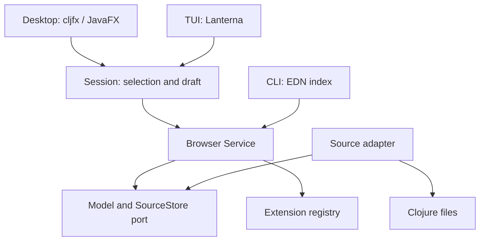

# Architecture

A single `deps.edn` project, with namespace boundaries and per-client aliases.
There are no empty modules for future features. No server or remote protocol
is started.

The arrows toward `SourceStore` represent code dependencies. The facade creates
the disk adapter at its composition point. The interfaces do not access
parsers, ranges, zippers or internal paths to write.

| Namespace | Responsibility |
|---|---|
| `csb.model` | SourceStore port and results/errors as data |
| `csb.source` | Discovery, parsing, revisions and byte replacement |
| `csb.service` | Facade, snapshot, serialization and recent changes |
| `csb.session` | Selection, draft, shared Save/Discard/Reload |
| `csb.editor` | Temporaries and external editor processes |
| `csb.extensions` | API v1, registry, collisions, capabilities and dispatch |
| `csb.cli` | Arguments and EDN output of the index |
| `csb.desktop` | cljfx descriptions and adaptation to JavaFX events |
| `csb.syntax` | Lexical text classification for both clients, with no UI, reading or semantic-validation dependencies |
| `csb.desktop.code-editor` | CodeArea life cycle and application of Desktop styles |
| `csb.tui` | Lanterna drawing/input/resize and key adaptation |
| `csb.tui-terminal` | POSIX input settings and restoration on TUI exit |
| `csb.tui-view` | Layout, 256-color themes and screen-buffer painting |

## State and identity

The service keeps a replaceable snapshot of the project. Each definition
carries namespace, name, kind, category, text, location, ID and a SHA-256
revision of the whole file. The editor keeps that revision next to the draft;
reloading the index does not legitimize an old draft.

The `[file top-level-ordinal]` ID is a locator within a revision. Changes
unrelated to the file do not modify it; inserting earlier forms can. It is not
used as historical identity. Duplicates are shown in read-only mode. The
association to generated vars is not invented.

## Source order and navigation order

`list-definitions` sorts by name, file and row. `list-categories` provides
facets with counts and a namespace summary (`total`/`files`); the session
composes those facets with the "(all)" entry (`:category` nil) and
filters only when a facet is chosen: by default the whole namespace is shown
([ADR 009](decisions/009-category-facets.md)). This visual organization does
not express the load order of the forms.
The adapter keeps file, range, location and ordinal within the revision;
Save replaces the form at its current location. There is no insertion,
movement or dependency analysis across definitions.

The source order view (`list-source-forms`) exposes per file all significant
top-level forms in their real order, including those not indexed as
definitions (`ns`, `declare`, `(comment ...)`, `#_`, `#=`, unknown heads).
Its ordinals match the `[file ordinal]` IDs because both count only
significant forms. Desktop shows it in a panel that replaces the editor
(`Esc` returns, selection navigates); the TUI presents it with `o` like the
other auxiliary panels. The `:source-order?` flag lives in the shared
session; the clients neither parse nor index. See
[ADR 008](decisions/008-source-order-view.md) and
[the design note](definition-order.md).

Order is semantically relevant in Clojure. Future design must keep navigation
order, persisted position and — once Live World exists — the requested
evaluation order separate. Displaying or validating references without
executing sources is not equivalent to demonstrating that the file loads.
[The definition-order note](definition-order.md) records the problem, the
current limits and the options that remain open.

## Saving

1. Check the definition is editable and the revision is still current.
2. Read the original bytes and check SHA-256.
3. Validate the draft is a single form, with the same name and kind.
4. Validate the reader without eval or custom data readers, and the `defn`
   form.
5. Preserve the original's prefix/suffix and encode only the replacement.
6. Validate the complete resulting document.
7. Write a temporary in the original directory, re-check the hash and replace
   atomically. Clean the temporary on error.
8. Reindex and record a `:source/saved` event with previous/new revisions.

The whole tree is not reserialized. The position map respects CRLF, CR, LF,
BOM and the parser's UTF-16 offsets. Bytes outside the range stay identical.
The last check and the move are distinct operations: there is a residual
window against non-cooperating external writers.

If the disk is updated but reindexing fails, a write success is returned with
`:reindex-error`. The UI reports that partial result and asks to reload. It
does not lead the user to believe the file was not written.

## Concurrency and effects

The service serializes its write/reload operations per open project. Desktop
dispatches I/O through its own executor, disabling editing during the
operation. The core knows neither that executor nor the JavaFX thread. The TUI
has a single interaction loop over the same service.

On POSIX, the TUI captures `stty` settings before building the terminal and
disables XON/XOFF so Ctrl+S reaches Lanterna. It closes the terminal before
restoring the original settings in `finally`, also on startup failure.
Windows does not use this POSIX adapter. This does not control shortcuts
intercepted outside the process by a terminal or by Emacs/EXWM.

External editor configuration is resolved in `csb.editor/command` before the
handoff: explicit EDN arguments or `VISUAL`/`EDITOR` commands split without a
shell. The process inherits the terminal and receives only a temporary. The
TUI presents its failures in an auxiliary panel that does not replace the
draft, with return via `Esc`. See
[ADR 007](decisions/007-external-editor-command.md).

The TUI loop compares the presented state and size before painting. The view
defines all backgrounds and foregrounds with indexed colors 16–255; `t`
toggles dark/light as local presentation state. It does not depend on the
basic ANSI palette or the default background. It paints the back buffer
without calling `Screen.clear` and requests DELTA refresh on normal changes.
Startup, resize and editor return invalidate the presentation and require
COMPLETE: the physical terminal may have been cleared even if the session
state stayed the same. When idle, no refresh is called; input/resize polling
continues without emitting output. No dependencies or domain logic are added
to the presentation.

The event history is an in-memory queue of the last 100 changes. It is not
presented as a Change Browser nor as a recovery mechanism. There are no
plugin callbacks running from a write's critical path.

## Extensions

Explicit registration of Clojure maps with API v1. Each contribution has a
namespaced ID, title, handler and required capabilities. Commands and views
receive a context with `:source/read` and a definition query. Handlers return
data; the clients choose how to present it.

Initial views are presented as textual data. The grammar for complex views
will be defined from real Test Runner needs. Extensions are trusted code in
the same JVM, with no security isolation.

## Dependency boundaries

The `:desktop` and `:tui` aliases are independent. Neither the base classpath
nor `:test` includes JavaFX, Lanterna or nREPL. Neither does `:tui` include
JavaFX. The Runtime Adapter and Test Runner will come after the MVP.

The Desktop editor uses RichTextFX exclusively in the `:desktop` alias.
The shared lexical classifier `csb.syntax` tolerates incomplete text, does not
access the index and does not execute readers. Desktop applies its UTF-16
ranges to the CodeArea; the TUI splits those tokens into lines and applies its
256-color palette before visible clipping, preserving multiline strings while
scrolling. Only line endings are normalized in the display copy; the draft
stays exact. Help and diagnostics remain plain text. Highlighting introduces
no new idle refreshes and no JavaFX dependencies in the TUI.
Styles are presentation; the session keeps the draft and Save still uses the
service's validation. See [ADR 004](decisions/004-syntax-highlighting.md)
and [ADR 006](decisions/006-shared-syntax.md).

## Opening and source dialects

The adapter discovers `.clj`, `.cljc` and `.cljd` within the configured roots.
ClojureDart reading is structural and read-only: it does not load the
compiler, Dart/Flutter dependencies or project readers. Saving keeps the
unambiguous `defn`/`defn-` limit in `.clj`.

When opening another project, the session clears filter, scroll and auxiliary
views. Desktop uses the selected project's source configuration; it does not
reuse the startup `--source-root` roots for another project. Openings and
reloads without namespaces report the examined roots and the supported
formats.
